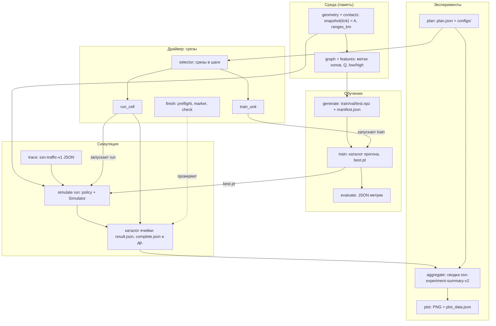

# 01. Архитектура. Часть 2 из 3: сквозной поток данных, диаграмма, расписание срезов

Метки и оговорки — как в `01_ARCHITECTURE_RU_part1.md`: «в коде написано», «вывод из чтения», «ручной расчёт»; ничего не запускалось, результатов нет. Имена файлов и схем взяты из кода (файлы и функции указаны); где источником служит описание группы 02-06, это сказано.

## 4. Сквозной поток данных по стадиям

Стадии 1-2 происходят в памяти процесса и файлов не создают. Каталоги и файлы создаются командами, которые отказываются писать в существующий путь (режим `"x"` у `provenance.write_json` и `experiment_io.write`; `mkdir(..., exist_ok=False)` в `simulate.run_single`).

1. **Геометрия и контакты** (`geometry.py`, `contacts.py`). Вход: `OrbitConfig` (по умолчанию `n = 132`, `planes = 12`, высота `1050.0` км, дальность `3500.0` км; `config.py`) и `phase_seed`. Выход: `GeometryNetwork.snapshot(tick)` → пара `(adjacency, ranges)`: булева матрица `n × n` (симметричная, диагональ пуста) и дальности `float64` в км. Для политики CGR дополнительно `build_geometric_plan(cfg)` строит план контактов по тикам от `0` до `horizon_tick − 1` (`docs/02`, часть 5).
2. **Графовые структуры** (`graph.py`, `features.py`). `shortest_hops(A)` → метки `int32` (`-1` — недостижимо), ось `[destination, candidate]`; `preprocessed_structure(A)` → `Q` (`float32`); `branch_inputs` → `low = A`, `high = [A | Q]`, список рёбер `[2, E]` (режим «только топология», по умолчанию). Это входы обучения и предсказания.
3. **Набор данных** (`data.py`, команда `generate`). Читает `Config` (`--config`) и ревизию; пишет каталог `--out` с `train.npz`, `val.npz`, `test.npz`, `manifest.json`. Положения берутся на моментах времени выборок; случайность — сиды наборов `DataConfig` (раздел 8 части 3).
4. **Обучение** (`training.py`, команда `train`). Читает `Config` и каталог набора; пишет каталог прогона: `config.json`, `dataset_manifest.json`, `provenance.json`, `history.jsonl`, `best.pt`, `best.json`, `complete.json` (`docs/03`, индекс). Метка `complete.json` завершает прогон.
5. **Оценка** (`evaluate`, необязательна для симуляции). Читает каталог прогона и набор данных, пишет один новый JSON метрик.
6. **Чекпойнт**. `best.pt` вместе с `config.json` прогона читает `training.load_trained_model` (CPU) при запуске GLR; `simulate.run_single` сверяет орбиту чекпойнта с орбитой симуляции и отказывает при совпадении фазового сида симуляции с сидами обучения, проверки и теста (`phase_seed` в объединении `train_seeds + val_seeds + test_seeds`).
7. **Трасса** (`traffic.py`, `simulate trace` или `experiments execute`/`driver.traces`). Читает `SimulationConfig`; пишет JSON схемы `ssn-traffic-v1` с полями `schema`, `trace_key`, `records`, `sha256`. Ключ `trace_key` не включает политику, фазовый сид, вероятность отказа и скорость канала (комментарий в `sim_config.trace_key`): один файл трассы может обслуживать несколько ячеек (вывод из чтения).
8. **Прогон одной ячейки** (`simulate.py`, `run`). Читает конфигурацию, трассу, при GLR — чекпойнт; пишет каталог `--out`: `config.json`, `traffic.json`, `provenance.json`, `packets.json` (схема `ssn-packet-table-v1`), `events.jsonl`, затем `result.json` (схема `ssn-simulation-result-v2`; для нативной политики `ssn-native-exhaustive-simulation-result-v1`) и `complete.json` с полями `simulation_finished` и `result_sha256`. В `result.json` записаны хеши пяти предыдущих файлов (`output_sha256`).
9. **Результат ячейки.** Ячейка — один сценарий для одной политики; её идентификатор `<id сценария>--<политика>` (`experiments.py`, `docs/05` часть A1). Каталог: `runs/<ячейка>/` в корне плана; журналы запуска — `logs/<ячейка>.{started.json, stdout.txt, stderr.txt, status.json}` (`run_cell`/`job`).
10. **Агрегирование** (`experiment_results.aggregate_plan`, `experiments aggregate`). Для каждой ячейки проверяет статус, `complete.json`, `result.json`, хеши, трассу, учёт пакетов; затем строит оценки по повторениям (тройкам сидов) и парные разности «политика минус эталон»; пишет один новый JSON схемы `ssn-experiment-summary-v2` (`ssn-native-exhaustive-experiment-summary-v1` для нативного плана). Неполная сводка возможна только с `--allow-partial`.
11. **Графики** (`experiment_plots.plot_summary`, `experiments plot`). Читает только сводку; пишет `plot_data.json`, PNG и `complete.json` (`docs/05`, часть D4). Нужен `matplotlib`.

## 5. Конвейер экспериментов вокруг стадий 3-10 (`experiments.py`)

`plan` читает файл серии и шаблоны, пишет `<root>/plan.json` (`{schema, body, sha256}`; схема `ssn-experiment-plan-v2`), `configs/training-n<N>.json` по одному на каждый N и `configs/s-<id>.json` по одному на сценарий. Корень `<root>` записывается в план как абсолютный путь. `train` создаёт `training_started.json`, `training_complete.json` и каталоги `training/n<N>/{data,run}` и файл `training/n<N>/test.json` дочерними процессами `generate`, `train`, `evaluate`. `execute` пишет `model_preflight.json` (при GLR), `execution_started.json`, трассы `traces/t-<trace_key>.json`, каталоги `runs/<ячейка>/`, журналы и `execution_complete.json`. Все пути внутри корня проверяет `experiment_io.inside` (абсолютные пути и `..` отвергаются). Код не требует выполнить `train` до `execute`: отсутствие чекпойнта обнаружит `preflight_models` (`docs/05`, часть A1).

## 6. Диаграмма

Стрелки «запускает» означают дочерний процесс `python -m ssn_hops ...` или `python -m ssn_hops.simulate ...` (`docs/06`, часть A3). Стрелка `FIN -.-> CELL` — вывод из чтения (`finish check` читает корень плана; подробности — `docs/06`, часть D1).

## 7. Расписание срезов драйвера (по `configs/slices_m1b_cgr.json` и `suite_m1b_cgr.json`)

Драйвер и конвейер срезов, показанные на диаграмме в разделе 6, в эту поставку не входят и удалены. Текст раздела сохранён без изменений как запись ревизии 3b.

План создаёт `python -m ssn_hops.experiments plan --suite configs/suite_m1b_cgr.json ...`. Затем драйвер выполняет срезы в произвольном порядке по выбору пользователя; порядок, заложенный в файле срезов (ключ `note`): сначала обучение, затем ячейки без CGR, затем ячейки CGR по одной в срезе (потому что лимит ячейки у среза — `cell_cap` его триггера, и ячейка, остановленная по лимиту, завершает свой срез). В `run_cell.main` перед шагами среза создаются трассы (`traces.ensure_traces`), а `plan_io.mark_started` пишет `execution_started.json` до проверки среза.

Серия (`suite_m1b_cgr.json`): пять троек сидов `[401,501,601]` … `[405,505,605]`; сетка `interruption` (`N = 132`, `planes = 12`, `failure_probability` = 0.0, 0.01, …, 0.06 — семь значений) и сетка `size` (`N` = 132/198/264/330, `planes` = 12/18/24/30, `p = 0.04`); область политики `CGR_contact_plan`: `n = [132]`, `failure_probability = [0.0, 0.02, 0.04, 0.06]`, `seed_tuple_indices = [0, 1, 2]`; переопределения обучения: `features = "adjacency_spliced_two_hop"`, `feature_version = 1`, `epochs = 300`.

Ручной расчёт числа сценариев и ячеек (по этим двум файлам; запуском не проверялось): пар `(N, p)` — 7 в сетке `interruption` и 4 в `size`, пара `(132, 0.04)` общая, итого 7 + 4 − 1 = 10; сценариев 10 × 5 = 50; ячеек без CGR 50 × 3 политики = 150; ячеек CGR 4 × 3 = 12; всего 162 (так же в `note` файла срезов). Обучающих единиц 4 (по одной на `N`).

| Срез | Содержание | Ячеек (ручной расчёт) |
|---|---|---|
| `TRAIN-132` | обучение `N = 132` | — |
| `TRAIN-REST` | обучение `N = 198` и `264` в одном запуске | — |
| `TRAIN-330` | обучение `N = 330` | — |
| `PILOT` | `N = 132`, `p = 0.04`, кортеж 0; GLR, TBR_style_hop_oracle, TSR_source_dijkstra | 3 |
| `B1B` | `N = 132` и `198`, три политики без ранее выбранных | (35 + 5) × 3 − 3 = 117 |
| `B264` | `N = 264` | 5 × 3 = 15 |
| `B330` | `N = 330` | 5 × 3 = 15 |
| `CGR-PILOT` | CGR, `N = 132`, `p = 0.04`, кортеж 0 | 1 |
| `CGR-EXT1` | CGR, `p = 0.04`, кортежи 1 и 2 | 2 |
| `CGR-EXT2` | CGR, `p = 0.0` и `0.06`, кортежи 0-2 | 6 |
| `CGR-EXT3` | CGR, `p = 0.02`, кортежи 0-2 | 3 |

Сумма ячеек: 3 + 117 + 15 + 15 + 1 + 2 + 6 + 3 = 162 (ручной расчёт). Здесь 35 = 7 значений `p` × 5 кортежей при `N = 132`, 5 = кортежи при `N = 198`, `p = 0.04`.

Лимиты, видимые в коде: лимит обучающей единицы по умолчанию — 120 минут (`DEFAULT_TRAIN_CAP_MINUTES = 120.0` в `run_cell.py`, также `train_cap_minutes` в параметрах среза); лимит ячейки задаётся `--cap-minutes` и действует на каждую ячейку; `--wall-minutes` ограничивает запуск целиком, но не прерывает начатую ячейку. Суммарного предела минут в коде нет: `ledger.py` только суммирует (`ELAPSED_EVENTS = ("finish", "capped")`). Если срез CGR не выполнен, план остаётся частичным: маркер завершения не создаётся, а `aggregate` требует `--allow-partial` (формулировка `note` файла срезов).

Журнал: `--ledger L.jsonl`, строка JSON на событие со схемой `ssn-m1-ledger-v1`; события `start`, `finish`, `capped`, `skipped`, `refused`, `discarded`.

## 8. Поправка к части 1

В части 1 (раздел 1, первый абзац) сказано, что обратных зависимостей между слоями нет. Это неточно: `graph.py` (слой «среда») импортирует `features.py` (слой «обучение»), см. таблицу зависимостей в разделе 2 части 1. Верно так: слои следуют друг за другом условно; жёсткой слоистости по импортам нет, а циклов при загрузке нет.
